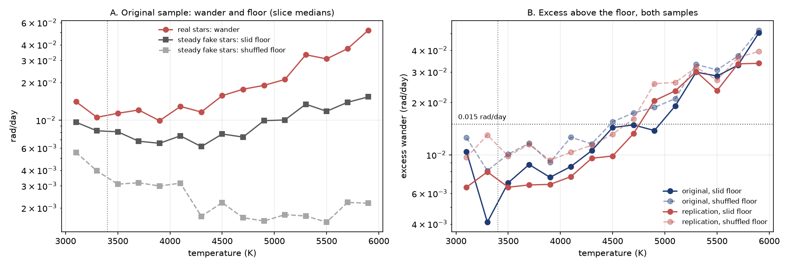

# Cooler Stars Keep Better Time

**TESS photometry shows a fourfold decline in rotation-rate wander from Sun-like stars to fully convective M dwarfs**

Aditrivaishnavi Balaji, BASIS Independent Silicon Valley. Sigma Xi IFoRE 2026 Student Research Competition, Physics & Astronomy. Abstract: [abstract.pdf](abstract.pdf), September 2026.



## The question

Starspots let us time a star's rotation: the star brightens and dims as the spots turn in and out of view. TESS observes each part of the sky for about 27 days at a time (a *sector*) and returns months or years later, so the same star's period can be measured many times. The period shifts a little from one sector to the next. This project calls that scatter the **wander**.

Like the Sun, a star can rotate faster at the equator than at the poles (differential rotation, or *shear*), so spots at different latitudes give different periods, and part of the wander could come from that. Fully convective M dwarfs, below about 3,400 K, have no radiative core, and theory predicts much weaker shear in them than in Sun-like stars. The measurements disagree: Doppler imaging of a few dozen stars finds shear falling steeply toward cooler stars, while Kepler's two-period method finds an almost flat trend, with very few stars below 3,500 K.

So: how does the wander change from Sun-like stars to fully convective M dwarfs, and does anything happen at the boundary?

## What was found

- 450 stars from 3,000 to 6,000 K, picked with the same brightness, period and sector-count limits at every temperature. Periods were refit in 4,317 sector light curves. For each star, a perfectly steady fake signal was injected into its own leftover noise and measured the same way, giving a noise floor for that star.
- After the floor is removed, Sun-like stars above 5,000 K wander about four times more than mid-M dwarfs below 3,400 K. At a fixed cutoff of 0.015 rad/day (about twice the floor), 83% of Sun-like stars are above it and 18% of mid-M dwarfs.
- The decline is smooth. There is no detectable jump at the fully convective boundary.
- A second sample of 422 different stars, drawn after its predictions were written down, met all three predictions.
- Light curves made independently by MIT's Quick-Look Pipeline show the same sector-by-sector deviations (Spearman ρ = 0.60 over 660 sectors of 60 stars).
- A spot-evolution model reproduces the Sun-like stars' wander with or without the published shear, but predicts 2.4 times too much wander for M dwarfs. So the wander reflects how fast spot patterns change more than it reflects shear. Cooler stars keep better time because their spot patterns stay coherent from month to month.

The full walk-through is in two notebooks:

1. [`notebooks/1_measuring_the_wander.ipynb`](notebooks/1_measuring_the_wander.ipynb): the sample, then the measurement built step by step on two example stars (light curve, period fit, wander, noise floor), then all 872 stars.
2. [`notebooks/2_results.ipynb`](notebooks/2_results.ipynb): the temperature trend, the fixed cutoff, the regression and boundary test, period dependence, the replication against its predictions, the early/late mission check, the independent light curves, the spot model, and a check of every number in the abstract.

## Running it

```bash
git clone https://github.com/aditrivaishnavi/cooler-stars-keep-better-time.git
cd cooler-stars-keep-better-time
python3 -m venv .venv
source .venv/bin/activate
pip install -r requirements.txt
jupyter lab notebooks/
```

Run notebook 1 and then notebook 2. With the saved results in `results/`, each takes under a minute. The example light curves in `data/examples/` are enough for the step-by-step part of notebook 1, so nothing needs to be downloaded.

To redo the whole measurement from the raw TESS light curves:

```bash
python get_data.py
```

This downloads 8,993 light curves (about 1 GB) from MAST into `data/lightcurves/`. Then set `RECOMPUTE = True` at the top of each notebook. On an 18-core laptop, measuring all 872 stars took about 25 minutes and the spot model about 5. With fewer cores it takes longer. Every random step uses a fixed seed, so a rerun gives the same numbers.

## What is in the repository

```
notebooks/1_measuring_the_wander.ipynb   Part 1: the sample and the measurement
notebooks/2_results.ipynb                Part 2: results and checks
wander.py          period fit, wander, noise floor, regression, QLP loader
spot_model.py      Butterpy spot-evolution model
get_data.py        downloads the light curves from MAST
data/star_lists/   the two samples (original_450.csv, replication_422.csv)
data/qlp_check_stars.csv    the 60 stars used for the QLP comparison
data/examples/     TARS light curves of the two example stars
data/abstract_numbers.json  numbers behind the submitted abstract
results/           per-star results, QLP deviations, spot model, abstract check
figures/           every figure, as saved by the notebooks
abstract.pdf       the conference abstract
```

`results/stars_original.csv` and `results/stars_replication.csv` have one row per star:

- `tic_id`, `teff`, `color`, `tmag`, `period`: TIC number, temperature (K), dereddened Gaia BP−RP colour, TESS magnitude and catalogue period (days), all from TARS
- `sectors`: sectors measured; `median_amplitude`: median fitted amplitude (relative flux)
- `wander`: robust scatter of 2π/P across sectors (rad/day)
- `floor_white`, `floor_shifted`: wander of fake steady stars made with shuffled or slid leftover noise
- `ratio_*`: wander / floor; `excess_*`: sqrt(wander² − floor²), in rad/day
- `early_wander`, `late_wander`: wander in sectors 1–60 and 61 onward
- `sector_periods`: the fitted period in each sector, as `sector:period`

## Timeline

- **1 September 2026.** The original 450-star sample was drawn from TARS before any light curve was measured. Every sector was refit and the first trend was measured with the shuffled-noise floor. In the afternoon, before any new stars were drawn, three predictions for a replication sample and a test with a red-noise-preserving (slid) floor were written down. The slid floor became the main one, and the 422-star replication met all three predictions. In the evening came the comparison with QLP light curves and the spot-evolution model.
- **2 September 2026.** The step-by-step notebooks were written, and the abstract was uploaded to the IFoRE submission form.
- **October 2026.** The notebooks were combined into the two here for the IFoRE presentation. The git history keeps the notebooks as they were on 2 September.

## Data and references

- TESS: Ricker et al. 2015, *JATIS* 1, 014003.
- TARS, the TESS All-Sky Rotation Survey: Boyle, Bouma & Mann 2026. Light curves from the TARS High Level Science Product on MAST; catalogue at [doi:10.5281/zenodo.19917941](https://doi.org/10.5281/zenodo.19917941).
- QLP, the MIT Quick-Look Pipeline: Huang et al. 2020, *RNAAS* 4, 204 and 206. Light curves from the QLP High Level Science Product on MAST.
- Butterpy: Claytor et al. 2022.
- Spot lifetimes: Giles, Collier Cameron & Haywood 2017, *MNRAS* 472, 1618.
- Shear and temperature from Doppler imaging: Barnes et al. 2005, *MNRAS* 357, L1; Collier Cameron 2007, *Astron. Nachr.* 328, 1030.
- Shear from Kepler: Reinhold, Reiners & Basri 2013, *A&A* 560, A4.
- Software: NumPy, SciPy, pandas, Matplotlib, Astropy, astroquery.
